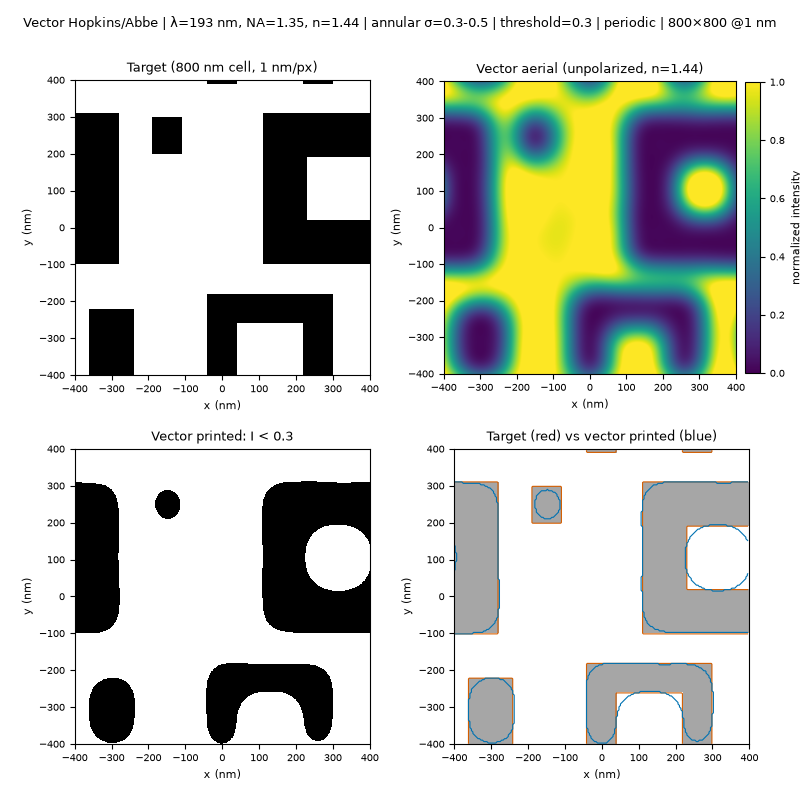

# 高 NA 矢量 Hopkins：layout_000005

## 设置

- 版图：`layout_000005_seed20260106.png`（800 nm 周期单元，3200×3200 @4 px/nm，压缩到 **800×800 @1 nm**）
- 光学：λ=193 nm，NA=1.35，浸没折射率 n=1.44
- 照明：环形 σ=0.3–0.5，144 个源点
- 成像：`IMAGING_MODEL="vector"`，`POLARIZATION="unpolarized"`
- 阈值：0.3；边界：periodic

## 结果

| 指标 | 矢量（unpolarized） | 标量对照（同 800×800 / 144 点） |
|---|---|---|
| aerial min | 0.0106 | 0.0039 |
| aerial max | 1.3728 | 1.4806 |
| aerial mean | 0.5924 | 0.5924 |
| 印刷暗区占比 | **0.3228** | 0.3473 |
| 目标暗区占比 | 0.3438 | 0.3438 |

矢量模式降低了空间像对比度（max 从 1.48 降到 1.37，min 从 0.004 升到 0.011），
在固定阈值 0.3 下暗区略微收缩；overlay 中可以看到更多角点圆化和边缘偏移。
这符合高 NA 矢量成像的预期。实际工艺中会重新校准剂量/阈值，但边缘对比度和
NILS 的下降仍然存在。

## 备注

- 当前矢量模型是**薄掩模**，不包含掩模 3D/EMF、apodization、偏振像差；
  因此仍然会比完整商用模型乐观，但已经比纯标量更接近实际。
- 标量对照结果来自同一版图、同一 800×800 @1 nm、144 源点、阈值 0.3 的标量运行。
- 另有一张 400×400 @2 nm 的标量/矢量并排对比：
  [hopkins_vector_vs_scalar_000005.png](hopkins_vector_vs_scalar_000005.png)。
